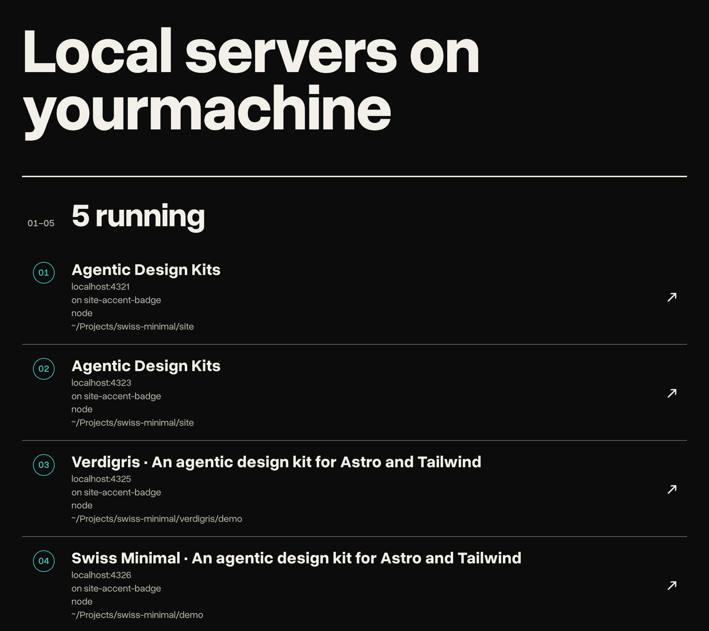

# localhosts

A tiny dark-mode landing page that lists every local dev server running on this Mac, with a clickable link to each.

Run `python3 localhosts.py`, then open **http://localhost:9999**. On a Mac it can also start itself at login: see "Starting it at login".



## What it shows

- Each server that's listening and answers with a real page, labeled with the page's own title and the project folder it was started from.
- The git branch checked out in that folder ("on main"), when the folder is in a git repository.
- Servers that return an error (like "not found") or don't answer within 2 seconds are hidden.
- Press **Refresh** under the title (or reload the page) to rescan.
- To also see non-dev apps (Adobe, Control Center, etc.) and the servers with no page, open **http://localhost:9999/?all=1**.

It only checks common dev tools: Node, Python, Ruby, PHP, Deno, Bun, Java, Go, Hugo, Jekyll, Caddy, nginx and similar. To add another, edit `DEV_COMMANDS` in `localhosts.py`.

No dependencies: just Python 3 and macOS's built-in `lsof`. See "Requirements".

## Projects: start and stop your dev servers

List your projects in `~/.config/localhosts/projects.json` and the page gets a **Projects** section under the running servers, one Swiss Minimal card per project. Each card has a **▶ Start** or **■ Stop** button, its status (● running in the accent color, ◐ starting, ● stopped in vermilion) and a **Log** button. Without the file, the section doesn't appear.

```json
{
  "projects": [
    { "name": "Marketing site", "dir": "~/Projects/marketing-site", "command": "npm run dev", "port": 4321, "screenshot": "screenshots/marketing-site.png" },
    { "name": "API", "dir": "~/Projects/api", "command": "uv run uvicorn app:app --reload --port 8000" }
  ]
}
```

- `dir` and `command` are required: the folder to run in and what you'd type there in a terminal.
- `name` is what the page shows. Without it, the folder's name.
- `port` is optional. A project counts as running when a server started in its folder is listening, or when something is listening on its `port`. Give the port if the server starts in a different folder, or to have Stop work on a server you started yourself in a terminal.
- `screenshot` is optional: an image shown on the project's card. A path relative to `projects.json`'s folder (`screenshots/site.png` is `~/.config/localhosts/screenshots/site.png`), or a full path. PNG, JPEG, WebP, GIF or AVIF. SVG isn't accepted, since an SVG can carry script that would run as the dashboard. A missing file shows "Screenshot not found" on the card.

To start, copy [`projects.example.json`](projects.example.json) from this repository and edit it:

```bash
mkdir -p ~/.config/localhosts/screenshots
```

```bash
cp projects.example.json ~/.config/localhosts/projects.json
```

To take a screenshot of a running site, use Chrome without opening a window (swap in the port and a file name):

```bash
"/Applications/Google Chrome.app/Contents/MacOS/Google Chrome" --headless=new --hide-scrollbars --window-size=1440,900 --screenshot="$HOME/.config/localhosts/screenshots/site.png" http://localhost:4321/
```

The file is read on every page load, so edits show up when you press Refresh. The file lives outside the repository because it holds your own folders and commands.

**How Start runs a command.** It opens your login shell (zsh on a Mac) as if in a new terminal, so your `PATH`, nvm, Homebrew and the like are set up, changes to `dir`, and runs `command`. When the folder or one above it has an `.nvmrc`, it runs `nvm use` first, so each project gets the Node version it asks for. A server takes a few seconds to come up: the project shows ◐ Starting until you press Refresh.

**Stop** ends the command and everything it started. For a project you started some other way, such as in a terminal, it stops the processes listening on that project's ports.

**Logs** are in `~/Library/Logs/localhosts/`, one file per project. The Log button shows the last 64 KB.

Projects the dashboard started keep running if the dashboard restarts, but it no longer knows it started them: Stop then works like it does for a server you started yourself, through the project's ports.

**Safety.** The page can run commands, so the server only accepts Start and Stop from its own page: a request needs the dashboard's address as its `Origin` and `Host`, and the page can't be shown inside another site's frame. Another website you visit can't press the buttons for you, and only the commands in your own `projects.json` can run.

## Styling

The page uses the [Swiss Minimal](https://www.swissminimal.ch) design kit in dark mode with the azure accent: a page title, then the kit's list row section, numbered with accent number circles.

- `swiss/kit/theme.css` and `swiss/kit/fonts.css`: copied from the kit, unchanged. The kit runs as plain CSS here, with no Tailwind.
- `swiss/fonts/`: Overused Grotesk and Source Code Pro, each with its license (SIL OFL 1.1).
- `site.css`: the list row grid, which the kit writes with Tailwind classes, written out with the kit's tokens.
- Icons are glyphs from Overused Grotesk itself (▶ ■ ● ◐ × ↻ ↗), so they match the type. The GitHub logo in the footer is the one SVG.
- `favicon.svg`: the kit's square favicon.

To pick up a newer version of the kit, copy those two CSS files and the fonts over again.

## Running it

From the repository's folder:

```bash
python3 localhosts.py
```

Then open **http://localhost:9999**. It runs until you press Ctrl+C or close the terminal. After editing `localhosts.py`, stop it and start it again to see the change.

To use a different port, change `PORT` at the top of `localhosts.py`.

## Starting it at login (optional, macOS)

A login item starts the dashboard when you log in and restarts it if it stops, so it's always at http://localhost:9999 without a terminal open. It's a launchd agent: one `.plist` file in `~/Library/LaunchAgents/`. That file isn't in the repository, since it holds your own paths.

1. Save this as `~/Library/LaunchAgents/com.localhosts.dashboard.plist`, replacing `/Users/YOU/Projects/localhosts` with the folder you cloned the repository into, and `/Users/YOU` with your home folder:

   ```xml
   <?xml version="1.0" encoding="UTF-8"?>
   <!DOCTYPE plist PUBLIC "-//Apple//DTD PLIST 1.0//EN" "http://www.apple.com/DTDs/PropertyList-1.0.dtd">
   <plist version="1.0">
   <dict>
       <key>Label</key>
       <string>com.localhosts.dashboard</string>
       <key>ProgramArguments</key>
       <array>
           <string>/usr/bin/python3</string>
           <string>/Users/YOU/Projects/localhosts/localhosts.py</string>
       </array>
       <key>WorkingDirectory</key>
       <string>/Users/YOU/Projects/localhosts</string>
       <key>RunAtLoad</key>
       <true/>
       <key>KeepAlive</key>
       <true/>
       <key>StandardOutPath</key>
       <string>/Users/YOU/Library/Logs/localhosts.log</string>
       <key>StandardErrorPath</key>
       <string>/Users/YOU/Library/Logs/localhosts.log</string>
   </dict>
   </plist>
   ```

   `/usr/bin/python3` is the Python that comes with macOS's command line tools. To use another Python, put its full path there (`which python3` prints it); launchd doesn't read your shell's `PATH`.

2. Stop any copy you started by hand, since both need port 9999. Then turn the login item on:

   ```bash
   launchctl bootstrap gui/$(id -u) ~/Library/LaunchAgents/com.localhosts.dashboard.plist
   ```

   It starts right away and again at every login. macOS shows a notification that a background item was added; you can see it under System Settings → General → Login Items & Extensions.

Output and errors go to `~/Library/Logs/localhosts.log`.

Restart it, after editing `localhosts.py` or pulling changes:

```bash
launchctl kickstart -k gui/$(id -u)/com.localhosts.dashboard
```

Turn it off (until you turn it on again with the `bootstrap` command above):

```bash
launchctl bootout gui/$(id -u)/com.localhosts.dashboard
```

To remove it for good, turn it off and then delete the `.plist` file.

## Requirements

- **macOS.** It should mostly work on Linux, as it relies on `lsof`, which you may need to install, but it hasn't been tested there. It doesn't work on Windows.
- **Python 3.8 or newer.** It uses only Python's standard library, so there's nothing to install.
- **Git**, for the branch line. It calls `/usr/bin/git`, which macOS offers to install with the Xcode command line tools the first time it's used. Without git, the page still works and leaves the branch line out.
- **Port 9999 free.** Otherwise it stops with "Address already in use". With the login item on, that includes running a second copy by hand.

## License

MIT, see [LICENSE](LICENSE). The Swiss Minimal kit files in `swiss/kit/` are MIT too. The fonts in `swiss/fonts/` are under the SIL Open Font License 1.1, each with its license file beside it.
